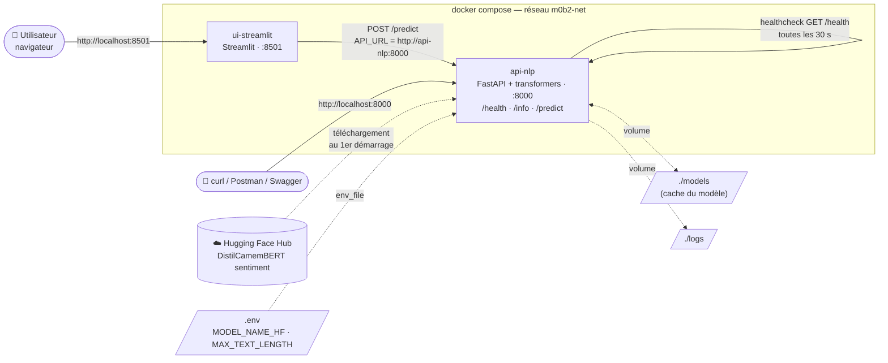

# ANALYSE — Sentiment FR · Aubergine Hôtels

## PARTIE 1 : schéma Mermaid + comment lancer

Analyse d'avis pour **Aubergine Hôtels** : le service classe des avis textuels
en 3 classes (**positif**, **neutre**, **négatif**), à partir du modèle
**cmarkea/distilcamembert-base-sentiment** (~270 Mo).

### Architecture



### Démarrage de la stack

#### 0. Cloner le repo

```bash
git clone git@github.com:<user>/M0-B2-sentiment-<pseudo>.git
cd M0-B2-sentiment-<pseudo>
```

#### 1. Environnement

> ⚠️ Docker Desktop : au moins **6 Go de mémoire** alloués, sinon le conteneur
> de l'API est tué sans message.

Récupération des variables `.env` :

```bash
cp .env.example .env
```

#### 2. Conteneurs Docker

**2.a Lancer la stack**

```bash
docker compose up --build
```

**2.b Stopper la stack**

Dans la console, pour arrêter le processus en cours : `Ctrl+C`, puis :

```bash
docker compose down
```

*La commande `up` ne retélécharge pas le modèle, grâce au cache de `./models`.*

#### 3. Vérification du lancement de la stack

```bash
curl http://localhost:8000/health        # API NLP
```

UI Streamlit (test via l'interface) : ouvre <http://localhost:8501> dans ton navigateur.

#### 4. Accès aux logs

```bash
docker compose logs -f api-nlp
```

#### 5. Accès Swagger

<http://localhost:8000/docs>

---

## PARTIE 2 : ≥ 3 reviews mal classées + explication

Voici la liste de trois reviews qui seront mal classées en utilisant ma méthode.

#### Avis n°7

> « Pas mauvais du tout, on s'attendait à pire vu les avis. Bonne surprise sur le rapport qualité-prix. »

- **Sentiment détecté :** négatif (3★)
- **Or** cet avis est déclaré **positif** par le sample
- **Raison :** négation utilisée pour décrire une situation positive, pas repérée par le modèle

#### Avis n°12

> « On a passé un séjour qu'on n'oubliera pas. La climatisation en panne en plein août, sympa. »

- **Sentiment détecté :** neutre (4★)
- **Or** cet avis est déclaré **négatif** par le sample
- **Raison :** sarcasme pas détecté par le modèle

#### Avis n°20

> « Charmant, décoration soignée, restaurant inventif. On reviendra dès que possible avec des amis. »

- **Sentiment détecté :** neutre (4★)
- **Or** cet avis est déclaré **positif** par le sample
- **Raison :** limite de notre décision qui nous donne un faux neutre :

  | 3★ | 4★ | 5★ |
  |---|---|---|
  | 0.09 | 0.48 | 0.42 |

Voir les avis Postman : [`postman_collection.json`](./postman_collection.json)

---

## PARTIE 3 : justification du mapping

### DECISION

**Situation :** hôtel, le propriétaire veut utiliser les avis clients pour améliorer ses services.

**Règle retenue :** 1★, 2★, 3★ → négatif / 4★ → neutre / 5★ → positif

**Point de vue retenu :**

- Consultation des autres utilisateurs afin de déterminer si le lieu leur correspond.
- Dans notre cas, c'est le propriétaire qui consulte ses résultats pour ensuite les classer.
- Les classer dans le but de régler les problèmes soulevés par les clients.
- En partant de ce postulat, un avis 5★ peut être considéré comme « parfait » car il a la note maximale, et donc normalement pas de défauts à corriger.
- Par contre, un avis 4★ est certes bon mais peut permettre de soulever des petits problèmes qui persistent dans l'établissement. Des efforts minimes seront à surveiller afin de transformer ces 4★ en 5★.
- Ensuite, nous pouvons considérer que les autres avis 1★, 2★, 3★ sont les plus éloignés de la note parfaite, et donc qu'il y a plus d'efforts à fournir de la part du propriétaire pour améliorer l'expérience client.
- Ces trois premiers niveaux peuvent donc être considérés comme négatifs par le propriétaire.

### Conséquences

Avec ce raisonnement, on peut prévoir un très grand nombre de résultats négatifs.
Cette décision implique une **charge de travail importante** pour le propriétaire. Il est essentiel ici de se mettre d'accord avec lui sur la charge qu'il est prêt à traiter.
Mais tous les avis classés comme tels auront un axe d'amélioration possible.

Étant donné que la décision maximise le rapatriement des avis vers négatif, il faut toutefois garder en tête que certains cas fondamentalement négatifs peuvent s'échapper vers le neutre/positif.

> ⚠️ Attention alors aux neutres et positifs, qui peuvent contenir des avis réellement négatifs.

### Méthode : étoile la plus probable

Nous prenons la décision de prendre la note la plus élevée des cinq probabilités. Car dans notre cas, les tranches 4 et 5 sont isolées et ne bénéficient pas de cette méthode. Alors que faire un choix par la somme d'un groupe (dans notre cas 1★/2★/3★) pourrait encore plus biaiser les résultats vers la réponse « négatif ».

